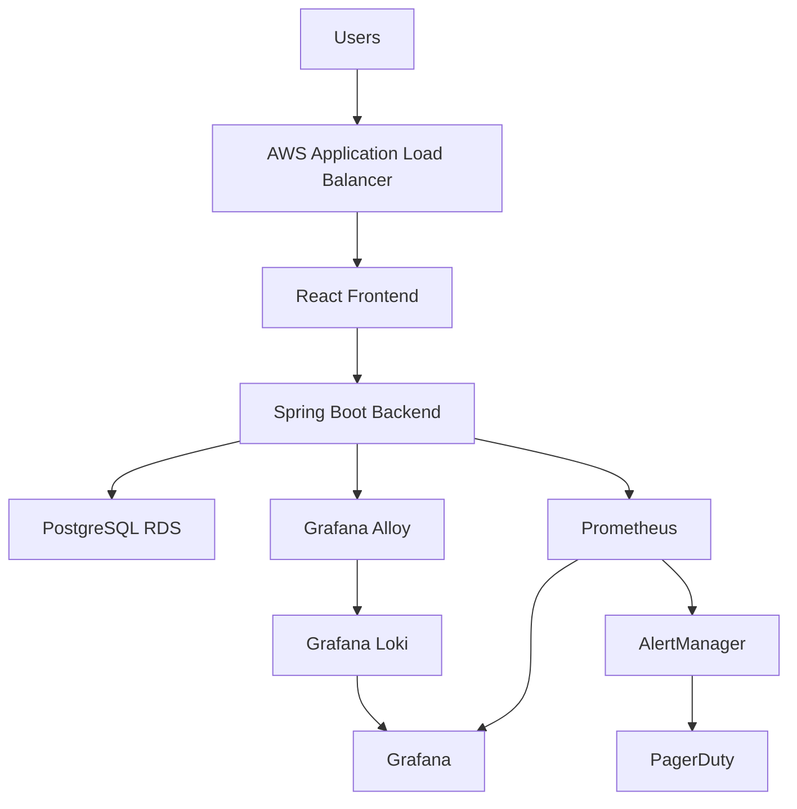
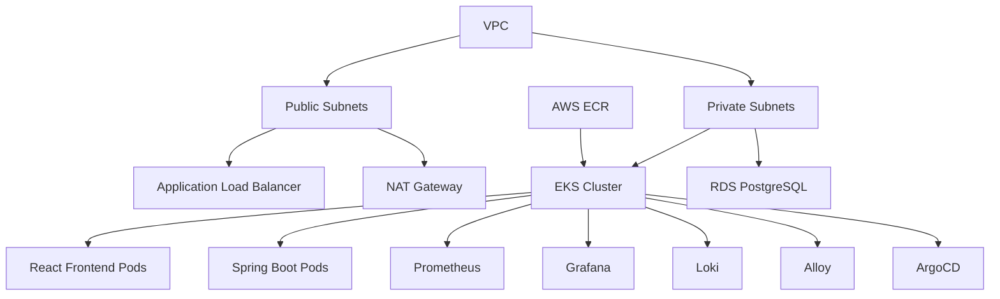
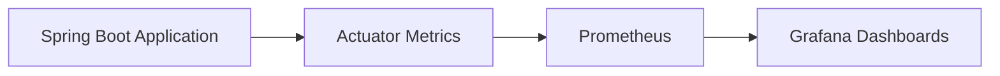
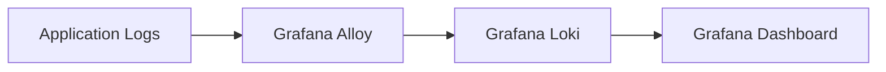
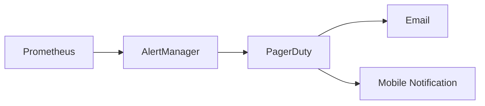

# 🚀 Ivaans Clothing Store - Employee Management System


## 📖 Overview

The **Ivaans Clothing Store Employee Management System** is a cloud-native application builtnd managers to securely manage employee data while leveraging:

- Infrastructure as Code (Terraform)
- Kubernetes Orchestration (Amazon EKS)
- GitOps Deployment (ArgoCD)
- CI/CD Automation (GitHub Actions)
- Monitoring & Alerting (Prometheus + Grafana)
- Centralized Logging (Loki + Alloy)
- Incident Response (PagerDuty)

---

## 🏢 Business Use Case

The application provides an internal employee management portal for Ivaans Clothing Store.

### Features

✅ User Authentication

✅ Add Employee

✅ View Employees

✅ Update Employee

✅ Delete Employee

✅ Kubernetes Self-Healing

✅ Monitoring & Alerting

✅ Centralized Logging

---

# 🏗️ Solution Architecture



---

# ☁️ AWS Infrastructure Architecture



---

# 🚀 DevOps Workflow

```mermaid
flowchart LR

A[Developer Pushes Code] --> B[GitHub Repository]

B --> C[GitHub Actions]

C --> D[Maven Build]

D --> E[Unit Testing]

E --> F[Checkov Scan]

F --> G[TFLint]

G --> H[Trivy Scan]

H --> I[Docker Build]

I --> J[Push Image to ECR]

J --> K[Update GitOps Repository]

K --> L[ArgoCD]

L --> M[AWS EKS]
```



---

# 📊 Monitoring Architecture



---

# 📝 Logging Architecture



---

# 🚨 Alerting Flow



---

# 🛠️ Technology Stack

| Category | Technology |
|-----------|-----------|
| Frontend | React.js |
| Backend | Spring Boot |
| Database | PostgreSQL RDS |
| Containerization | Docker |
| Orchestration | Kubernetes (EKS) |
| Infrastructure as Code | Terraform |
| CI/CD | GitHub Actions |
| GitOps | ArgoCD |
| Monitoring | Prometheus |
| Visualization | Grafana |
| Logging | Loki |
| Log Collection | Alloy |
| Alerting | AlertManager |
| Incident Management | PagerDuty |
| Container Registry | AWS ECR |

---

# 📂 Project Structure

```text
ivaans-employee-management/
│
├── frontend/
│   ├── src/
│   ├── public/
│   └── Dockerfile
│
├── backend/
│   ├── src/
│   ├── pom.xml
│   └── Dockerfile
│
├── terraform/
│   ├── modules/
│   │   ├── vpc/
│   │   ├── eks/
│   │   ├── ecr/
│   │   ├── rds/
│   │   ├── alb/
│   │   └── iam/
│
├── kubernetes/
│   ├── frontend/
│   ├── backend/
│   ├── ingress/
│   └── monitoring/
│
├── gitops/
│   ├── frontend/
│   ├── backend/
│   └── argocd/
│
└── README.md
```

---

# 🔐 DevSecOps Controls

### Terraform Validation

```bash
terraform validate
```

### Terraform Linting

```bash
tflint
```

### Infrastructure Security Scan

```bash
checkov -d .
```

### Container Image Scan

```bash
trivy image employee-app:latest
```

---

# ♻️ Self-Healing Demonstration

Delete an application pod:

```bash
kubectl delete pod employee-backend
```

Kubernetes automatically recreates the pod.

Verify:

```bash
kubectl get pods -w
```

---

# 📈 Future Enhancements

- Horizontal Pod Autoscaler (HPA)
- Cluster Autoscaler
- AWS Secrets Manager
- OpenTelemetry
- Splunk Observability
- Multi-Tenant Architecture
- Attendance Module
- Payroll Management

---

# 👨‍💻 Author

### Uttam Singh

Cloud Engineer | DevOps Engineer | AWS | Terraform | Kubernetes | GitOps | Observability

---

## ⭐ Key Learning Outcomes

- Terraform Infrastructure Automation
- AWS EKS Administration
- Docker Containerization
- GitHub Actions CI/CD
- GitOps with ArgoCD
- Kubernetes Self-Healing
- Prometheus Monitoring
- Grafana Observability
- Loki Logging
- DevSecOps Security Scanning
- PagerDuty Alerting
